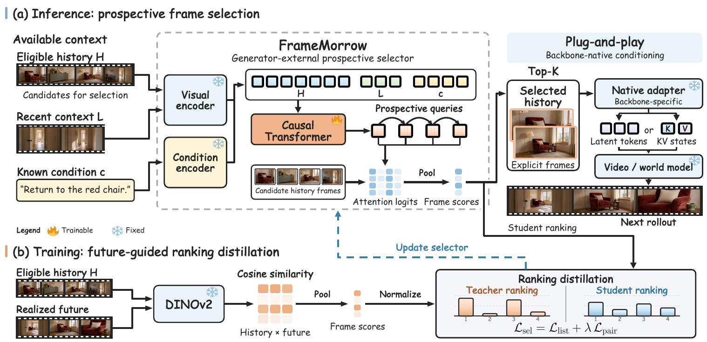
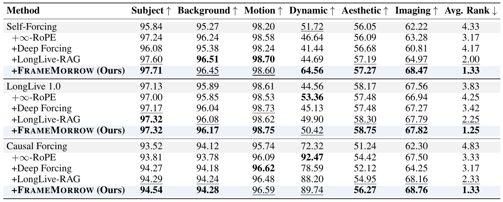
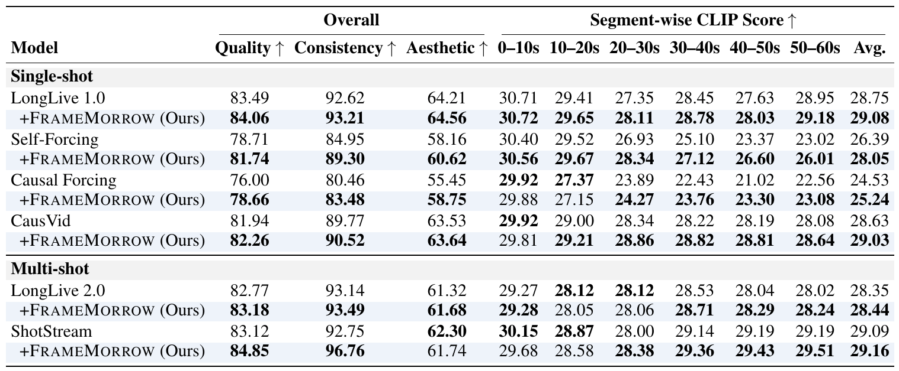
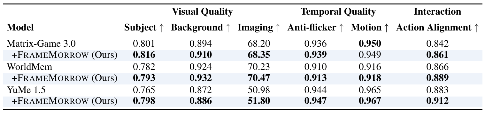

<div align="center">

# FrameMorrow

**Future-Guided Frame Selection with Prospective Tokens for Long-Horizon Video Generation**

[](https://arxiv.org/abs/2609.38839)
[](https://yinbo0927.github.io/FrameMorrow/)
[](https://huggingface.co/papers/2609.38839)
[](LICENSE)

<p>Bo Yin<sup>1</sup>, Xiaobin Hu<sup>1</sup>, Jiaqi Zhao<sup>1,2</sup>, Shuicheng Yan<sup>1</sup></p>

<p><sup>1</sup> National University of Singapore<br>
<sup>2</sup> Harbin Institute of Technology, Shenzhen</p>

</div>

## What is FrameMorrow?

**FrameMorrow selects historical frames for what comes next.** Prospective tokens predict useful history from observed frames and the current condition. Future observations supervise training only.

<p align="center">
  
</p>

## Repository layout

| Path | Contents |
| --- | --- |
| [`framemorrow/`](framemorrow/) | Selector, losses, encoders, and generator adapters |
| [`configs/`](configs/) | Data, training, and model configurations |
| [`examples/`](examples/) | Runnable Self-Forcing and LongLive examples |
| [`docs/`](docs/) | Project website and video comparisons |

## Setup

**1. Clone the repository**

```bash
git clone https://github.com/YinBo0927/FrameMorrow.git
cd FrameMorrow
```

**2. Install the environment** (Linux, Python 3.12, CUDA 12.8)

```bash
conda create -n framemorrow python=3.12 -y
conda activate framemorrow
conda install -c conda-forge ffmpeg -y
python -m pip install --upgrade pip setuptools wheel
python -m pip install -r requirements.txt
python -m pip install -e . --no-deps
```

## Usage

Run the following steps in order from the repository root. The default configuration uses all OpenVidHD videos.

```bash
export DATA_DIR=data/openvidhd
export RUN_DIR=runs/openvidhd
```

**1. Download and annotate**

```bash
python download_data.py plan "$DATA_DIR/raw"
python download_data.py fetch "$DATA_DIR/raw/download_plan.json"
python annotate.py "$DATA_DIR/raw/videos.jsonl" "$DATA_DIR/annotations" \
  --model Qwen/Qwen3-VL-8B-Instruct --device cuda --condition-seconds 4
```

Source: [OpenVidHD](https://huggingface.co/datasets/nkp37/OpenVid-1M/tree/main/OpenVidHD). Rerun `fetch` to resume downloads. Add `--resume` to continue annotation with the same settings.
If Hugging Face is unreachable, set `export HF_ENDPOINT=https://hf-mirror.com` before downloading.

**2. Prepare frames and features**

```bash
python prepare.py "$DATA_DIR/annotations/videos.jsonl" "$DATA_DIR/tuples" --seed 0
python encode.py "$DATA_DIR/tuples/tuples.jsonl" "$DATA_DIR/features" \
  --modality text --device cuda --max-condition-tokens 256
```

Features use frozen DINOv2 ViT-B/14 and UMT5-XXL. Models download automatically. Clips without valid training windows are listed in `preparation_report.json`.

**3. Train the selector**

```bash
python train.py "$DATA_DIR/features/features.jsonl" \
  --config configs/text.json --output "$RUN_DIR"
```

Saves `best.pt` and `last.pt`. Add `--resume "$RUN_DIR/last.pt"` to resume the same run.

**4. Select frames**

```bash
python select_frames.py "$RUN_DIR/best.pt" \
  --input "$DATA_DIR/tuples/observed.json" \
  --output outputs/selected.json --device cuda
```

Returns frame paths, timestamps, indices, and scores. Custom inputs contain `history`, `recent`, and `prompt`. Frame paths are relative to the input JSON. Future frames are excluded at inference. Selector weights are not bundled.

### Configuration

Edit [`configs/default.json`](configs/default.json). CLI flags override JSON settings. Both `plan` and `train.py` accept `--settings FILE`.

| Setting | Default | Purpose |
| --- | --- | --- |
| `data.count` | `null` | All videos. Set an integer for a subset. |
| `data.min_seconds` / `min_aesthetic` | `0` / `null` | Optional data filters |
| `training.epochs` / `batch_size` / `lr` | `5` / `64` / `1e-4` | Training parameters |
| `inference.k` | `2` | Number of historical reference frames |

For a small run, add `--count 20 --min-seconds 12` to `plan` and `--epochs 1 --batch-size 16` to training. Model architecture is configured in [`configs/text.json`](configs/text.json). Use new output directories for separate runs.

### Video generation example

Download the backends and weights, then run either generator:

```bash
python examples/setup_generators.py

# longlive
python examples/longlive.py --selector-checkpoint "$RUN_DIR/best.pt" --output outputs/longlive

# self-forcing
# python examples/self_forcing.py --selector-checkpoint "$RUN_DIR/best.pt" --output outputs/self_forcing
```

Uses 2 historical frames by default. Change this with `--k`. Each example saves `conditioned.mp4` in its output directory.

## Results

<p align="center"><strong>Long video generation on MovieGenBench.</strong></p>

<p align="center">
  
</p>

<br>

<p align="center"><strong>Interactive video generation under single-shot and multi-shot conditions.</strong></p>

<p align="center">
  
</p>

<br>

<p align="center"><strong>Action-conditioned interactive world models.</strong></p>

<p align="center">
  
</p>

## Citation

```bibtex
@article{yin2026framemorrow,
  title={FrameMorrow: Future-guided Frame Selection with Prospective Tokens for Long-Horizon Video Generation},
  author={Yin, Bo and Hu, Xiaobin and Zhao, Jiaqi and Yan, Shuicheng},
  journal={arXiv preprint arXiv:2609.38839},
  year={2026}
}
```
